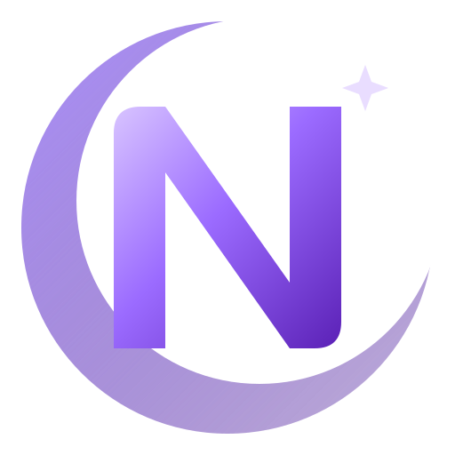

<p align="center"></p>

# Noctoware Linux 0.1 Alpha

An Arch Linux–based rolling release with the **CachyOS kernel**, **Hyprland +
HyDE** as the default desktop, optional **KDE Plasma 6**, Steam preinstalled,
and AI development tools ready to go.

| | |
|---|---|
| Base | Arch Linux (pacman, systemd), rolling |
| Kernel | `linux-cachyos` (+ `linux-cachyos-lts` recovery kernel) from `[cachyos]` |
| Desktop | Hyprland + HyDE (default), KDE Plasma 6 Wayland (optional), Revo Shell (opt-in, fetched from upstream) |
| Login / installer | SDDM (Noctoware theme) / Calamares |
| Filesystem | Btrfs + snapper + snap-pac (default), ext4 optional |
| Boot | systemd-boot (UEFI), GRUB (BIOS) |
| Audio / network / BT | PipeWire + WirePlumber / NetworkManager / BlueZ |
| Gaming | Steam, Proton, Gamescope, GameMode, MangoHud, per-GPU Vulkan drivers |
| AI tools | Codex CLI preinstalled; Claude Code via consent-based official installer |
| Updates | `sudo pacman -Syu` — Noctoware, CachyOS and Arch packages together |

## Quick start (developers)
```
scripts/prepare.sh
scripts/build-packages.sh
sudo scripts/build-iso.sh
scripts/test-iso.sh all
```
See [docs/BUILD.md](docs/BUILD.md), [docs/TESTING.md](docs/TESTING.md),
[docs/PROGRESS.md](docs/PROGRESS.md) and [docs/KNOWN_ISSUES.md](docs/KNOWN_ISSUES.md).

## Documentation
* [Build](docs/BUILD.md) · [Testing](docs/TESTING.md) · [Package repository](docs/REPOSITORY.md)
* [Snapshots & recovery](docs/RECOVERY.md) · [GPU drivers](docs/GPU.md) · [Secure Boot](docs/SECURE_BOOT.md)
* [AI tools](docs/AI_TOOLS.md) · [Revo Shell](docs/REVO.md) · [KDE Plasma](docs/PLASMA.md)
* [Third-party licenses](THIRD_PARTY_LICENSES.md)

## License
Noctoware code: MIT. Artwork: CC-BY-SA-4.0. Third-party components keep their
own licenses — see [THIRD_PARTY_LICENSES.md](THIRD_PARTY_LICENSES.md).
